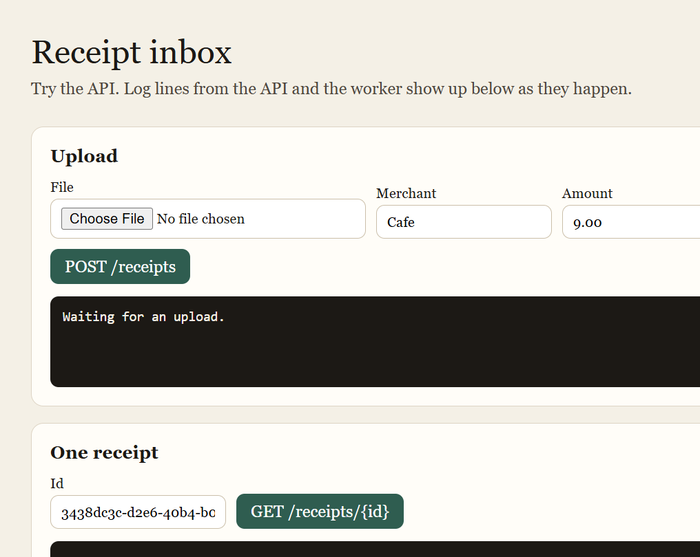
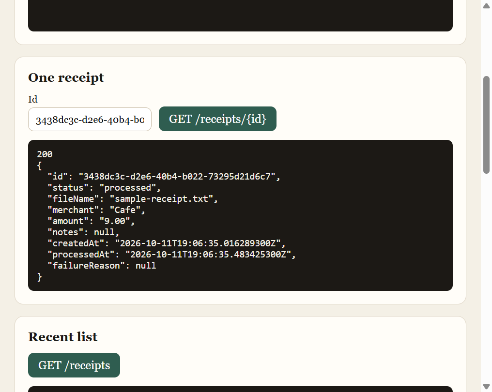
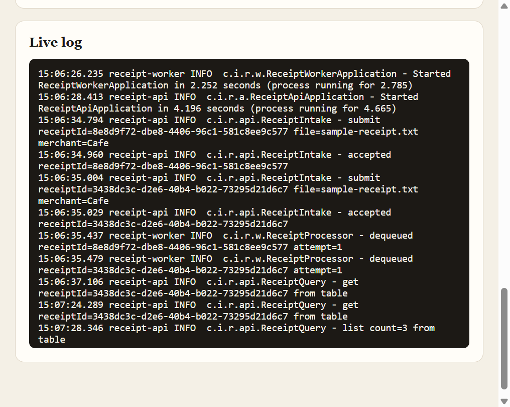
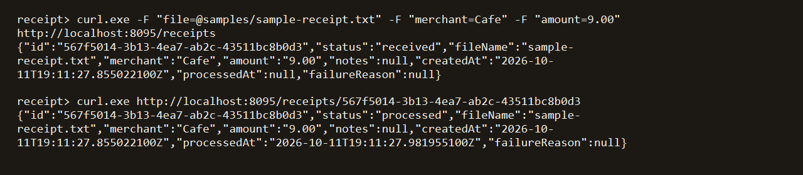

# Receipt inbox

A small Java system that takes a receipt upload, stores it, and processes it on a worker. It is meant to be read and run locally. Azure is optional.

`receipt-api` accepts the file. It writes the bytes to Blob Storage, a row to Table Storage, and a job to Queue Storage, then returns `202` with status `received`. `receipt-worker` reads the queue, marks the row `processed`, and can park a failing job on a poison queue. Redis is an optional cache for later reads. There is no OCR.

With no Azure account, both apps talk to [Azurite](https://github.com/Azure/Azurite), the local Storage emulator. The container, table, and queues are created on startup.

## Layout

| Module | Role |
| --- | --- |
| `receipt-api` | HTTP API and the page at `http://localhost:8080` |
| `receipt-worker` | Queue consumer. No HTTP port. |
| `receipt-common` | Storage, queue, table, and Redis clients |
| `infra` | Optional Bicep for a resource group you create yourself |

## Prerequisites

- Java 21
- Maven 3.9 or newer
- Node.js, only if you want Azurite through `npx`

Unit tests do not need Azurite or Azure:

```powershell
mvn test
```

## Run locally

Start Azurite in its own terminal:

```powershell
npx --yes azurite --silent --location ./azurite-data
```

In two more terminals, point both apps at Azurite. This connection string is the public emulator key published by Microsoft. It is not a cloud credential.

```powershell
$env:AZURE_STORAGE_CONNECTION_STRING = "DefaultEndpointsProtocol=http;AccountName=devstoreaccount1;AccountKey=Eby8vdM02xNOcqFlqUwJPLlmEtlCDXJ1OUzFT50uSRZ6IFsuFq2UVErCz4I6tq/K1SZFPTOtr/KBHBeksoGMGw==;BlobEndpoint=http://127.0.0.1:10000/devstoreaccount1;QueueEndpoint=http://127.0.0.1:10001/devstoreaccount1;TableEndpoint=http://127.0.0.1:10002/devstoreaccount1;"
$env:REDIS_ENABLED = "false"
```

Install once so each app can see `receipt-common`:

```powershell
mvn -DskipTests install
```

Start the worker first, then the API:

```powershell
mvn -pl receipt-worker spring-boot:run
```

```powershell
mvn -pl receipt-api spring-boot:run
```

Open `http://localhost:8080`. Upload `samples/sample-receipt.txt`. The page shows the `202`, and the live log shows the API and the worker. The status becomes `processed` after the worker takes the message.







The same call from a terminal:

```powershell
curl.exe -F "file=@samples/sample-receipt.txt" -F "merchant=Cafe" -F "amount=9.00" http://localhost:8080/receipts
curl.exe http://localhost:8080/receipts/<id>
curl.exe http://localhost:8080/receipts
```



`azurite-data/` is local emulator state. It is gitignored.

## Optional: deploy to your own Azure resource group

The templates do not name an existing account, cache, or subscription. Storage and Redis names default to a hash of the resource group, so two people do not collide. Override `storageName` or `redisName` if you want a name you can remember. Do not commit connection strings or keys.

```powershell
az group create --name receipt-inbox --location eastus
az deployment group create --resource-group receipt-inbox --template-file infra/main.bicep --parameters infra/main.parameters.json
```

Copy the deployment outputs into the session that starts each app. `storageConnectionString` is `AZURE_STORAGE_CONNECTION_STRING`. `appInsightsConnectionString` is `APPLICATIONINSIGHTS_CONNECTION_STRING`. Leave Redis off until you deploy it.

```powershell
$env:AZURE_STORAGE_CONNECTION_STRING = "<storageConnectionString>"
$env:APPLICATIONINSIGHTS_CONNECTION_STRING = "<appInsightsConnectionString>"
$env:REDIS_ENABLED = "false"
```

Redis is a separate template. Pass the workspace resource id from the main deployment. The key is not a template output. Read it with `list-keys` and keep it in the session.

```powershell
$workspaceId = az monitor log-analytics workspace show --resource-group receipt-inbox --workspace-name receipt-inbox-logs --query id -o tsv
az deployment group create --resource-group receipt-inbox --template-file infra/redis.bicep --parameters infra/redis.parameters.json workspaceResourceId=$workspaceId
az redisenterprise database list-keys --cluster-name <redisName> --resource-group receipt-inbox --name default
```

Set `REDIS_ENABLED` to `true`, `REDIS_HOST` to the `redisHost` output, `REDIS_PORT` to `10000`, and `REDIS_PASSWORD` to `primaryKey`. Restart both apps.

`infra/apps.bicep` is an optional Container Apps deployment. It expects the storage account, workspace, Application Insights component, and Redis cluster to already exist. Pass `acrName`, `storageAccountName`, and `redisName` yourself. Leave `deployApps` false until the images are in the registry. The template reads keys at deploy time. It does not store them in the file.

When you are done:

```powershell
.\infra\delete-resources.ps1 -ResourceGroup receipt-inbox
```

That deletes the resource group and everything in it.
